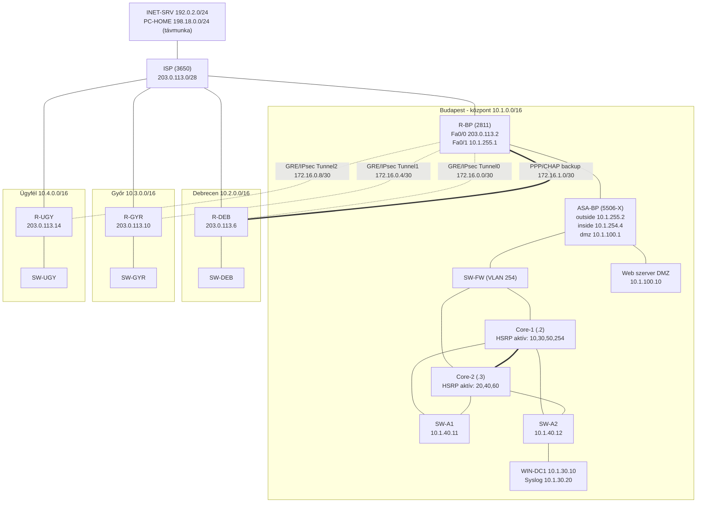

# Uroborosz Biztonság Kft. - hálózati leírás (labor)

Készítette: Holósi Tamás, Gerse Bálint, Forgács-Balajthy Marcell  Szakmai vizsgaremek  Cisco Packet Tracer 8.2.2 (`uroborosz-v1.pkt`)

## 1. Áttekintés

Négy telephely (Budapest központ, Debrecen, Győr, mintaügyfél) egy szimulált ISP-n keresztül kapcsolódik össze.
A telephelyeket GRE over IPsec alagutak kötik a központi routerhez (R-BP), Debrecenhez tartalék PPP/CHAP soros kapcsolat is tartozik.
A központban redundáns core (HSRP), tűzfal (ASA), DMZ, központi DHCP/DNS (WIN-DC1) és távmunkás VPN működik.

## 2. Topológia

Jelmagyarázat: folytonos vonal = fizikai kapcsolat - szaggatott = IPsec alagút - dupla vonal = port-channel (Core-1-Core-2, LACP) és a soros tartalék.

## 3. Fizikai és WAN összeköttetések

| Kapcsolat | Eszköz / port | Cím | Megjegyzés |
|---|---|---|---|
| ISP - R-BP | ISP Gi1/0/1 - R-BP Fa0/0 | 203.0.113.1 / .2 /30 | v6: 2001:DB8:FFFF:1::/64 |
| ISP - R-DEB | ISP Gi1/0/2 - R-DEB Fa0/0 | 203.0.113.5 / .6 /30 | v6: 2001:DB8:FFFF:2::/64 |
| ISP - R-GYR | ISP Gi1/0/3 - R-GYR Fa0/0 | 203.0.113.9 / .10 /30 | v6: 2001:DB8:FFFF:3::/64 |
| ISP - R-UGY | ISP Gi1/0/4 - R-UGY Fa0/0 | 203.0.113.13 / .14 /30 | v6: 2001:DB8:FFFF:4::/64 |
| ISP - INET-SRV | ISP Gi1/0/5 | 192.0.2.1/24 | internetes szerver |
| ISP - PC-HOME | ISP Gi1/0/6 | 198.18.0.1/24 | távmunkás gép |
| R-BP - ASA | R-BP Fa0/1 - ASA Gi1/1 (outside) | 10.1.255.1 / .2 /30 | v6: 2001:DB8:1:FF::/64 |
| ASA - SW-FW - Core | ASA Gi1/2 (inside) → SW-FW → Core-1/2 Gi1/0/3 | 10.1.254.0/29 (ASA .4, Core-1 .2, Core-2 .3, HSRP .1) | VLAN 254 TRANSIT |
| ASA - DMZ | ASA Gi1/3 (dmz) | 10.1.100.1/24 | web: 10.1.100.10 |
| Core-1 - Core-2 | Gi1/0/23-24 | - | LACP Port-channel 1, trönk, natív VLAN 99 |
| Core → access | Core Gi1/0/1 → SW-A1, Gi1/0/2 → SW-A2 | - | trönk, natív VLAN 99 |
| R-BP - R-DEB (tartalék) | Serial0/0/0 - Serial0/0/0 | 172.16.1.1 / .2 /30 | PPP + CHAP, bandwidth 64 |

## 4. Alagutak (GRE over IPsec)

| Alagút | R-BP oldal | Telephely oldal | Cél (WAN) | Crypto map |
|---|---|---|---|---|
| Tunnel0 - Debrecen | 172.16.0.1/30 | 172.16.0.2/30 | 203.0.113.6 | CM 10, ACL 101 |
| Tunnel1 - Győr | 172.16.0.5/30 | 172.16.0.6/30 | 203.0.113.10 | CM 20, ACL 102 |
| Tunnel2 - Ügyfél | 172.16.0.9/30 | 172.16.0.10/30 | 203.0.113.14 | CM 30, ACL 103 |

- ISAKMP: AES-256, pre-shared key, DH group 5. IPsec transform: `esp-aes 256 esp-sha-hmac`.
- A crypto map a fizikai WAN interfészen van, a védett forgalom az `permit gre host <helyi> host <távoli>` ACL.
- Tunnel MTU 1476. Ha egy alagút módosítás után elakad: `no crypto map CM` / `crypto map CM` a WAN interfészen.

## 5. VLAN-ok és címzés

| VLAN | Név | Hálózat (HQ) | Gateway (HSRP VIP) | Core-1 / Core-2 | Aktív HSRP |
|---|---|---|---|---|---|
| 10 | SOC | 10.1.10.0/24 | 10.1.10.1 | .2 / .3 | Core-1 (prio 110) |
| 20 | DEV | 10.1.20.0/24 | 10.1.20.1 | .2 / .3 | Core-2 |
| 30 | SERVERS | 10.1.30.0/24 | 10.1.30.1 | .2 / .3 | Core-1 (prio 110) |
| 40 | MGMT | 10.1.40.0/24 | 10.1.40.1 | .2 / .3 | Core-2 |
| 50 | WIFI-STAFF | 10.1.50.0/24 | 10.1.50.1 | .2 / .3 | Core-1 (prio 110) |
| 60 | WIFI-GUEST | 10.1.60.0/24 | 10.1.60.1 | .2 / .3 | Core-2 |
| 70 | IOT | (Ügyfél telephely) | - | - | - |
| 99 | PARKING | nincs IP | - | - | - (használaton kívüli portok, natív VLAN) |
| 100 | DMZ | 10.1.100.0/24 | ASA 10.1.100.1 | - | - |
| 254 | TRANSIT | 10.1.254.0/29 | 10.1.254.1 | .2 / .3 | Core-1 (prio 110) |

Telephelyek: Debrecen 10.2.0.0/16 (VLAN 30, 40, 50), Győr 10.3.0.0/16 (VLAN 40, 50), Ügyfél 10.4.0.0/16 (VLAN 40, 70).
Távmunkás VPN-pool: 10.9.0.10 - 10.9.0.50. Publikus (NAT) tartomány: 198.51.100.0/29.
IPv6: 2001:DB8:`<telephely>`::/48 (HQ = 2001:DB8:1::/48, DEB = :2::, GYR = :3::, ÜGY = :4::).

## 6. Eszközök és menedzsment-címek

| Eszköz | Típus | Szerep | Menedzsment / fő cím |
|---|---|---|---|
| ISP | Catalyst 3650-24PS | szolgáltató, routed portok | 203.0.113.1 |
| R-BP | Cisco 2811 | HQ router, alagút-hub, NAT, távmunkás VPN | 203.0.113.2 / 10.1.255.1 |
| ASA-BP | ASA 5506-X | tűzfal (outside/inside/dmz) | 10.1.254.4 |
| Core-1, Core-2 | Catalyst 3650-24PS | L3 core, HSRP v2, Rapid-PVST | 10.1.254.2 / .3 |
| SW-A1, SW-A2 | Catalyst 2960 | access (HQ) | 10.1.40.11 / .12 |
| SW-FW | Catalyst 2960 | 254-es VLAN aggregáló | - |
| R-DEB, R-GYR, R-UGY | Cisco 2811 | telephelyi routerek | WAN: 203.0.113.6 / .10 / .14 |
| SW-DEB, SW-GYR, SW-UGY | Catalyst 2960 | telephelyi access | MGMT VLAN 40 |
| WIN-DC1 | Windows Server | AD, DNS, DHCP | 10.1.30.10 |
| Syslog | szerver | naplógyűjtés | 10.1.30.20 |
| Web (DMZ) | szerver | nyilvános weboldal | 10.1.100.10 (NAT: 198.51.100.2) |

## 7. Protokollok és szolgáltatások

| Terület | Megoldás |
|---|---|
| Útválasztás | OSPF process 1, area 0 (R-BP 1.1.1.1, R-DEB 2.2.2.2, R-GYR 3.3.3.3, R-UGY 4.4.4.4); alagutakon és a soros tartalékon; statikus alapértelmezett útvonalak a WAN felé; IPv6 statikus útvonalak |
| Redundancia | HSRP v2 preemptes, 3 + 3 VLAN felosztva a két core között; LACP port-channel; Rapid-PVST (Core-1 root prio 24576, Core-2 28672); PPP/CHAP soros tartalék Debrecenhez |
| Titkosított átvitel | GRE over IPsec (ISAKMP AES-256/SHA, DH5, PSK) |
| Távmunka | Easy VPN (IPsec, csoport UROVPN, pool 10.9.0.10-50, XAUTH helyi felhasználóval); a VPN-ről a 10.1.30.0/24 szerverhálózat érhető el |
| NAT | R-BP: statikus 10.1.100.10 → 198.51.100.2; GUEST pool 198.51.100.3-6 a VLAN 60-nak; PAT a 10.1.0.0/16-nak a WAN interfészre |
| Tűzfal | ASA: security-level 0/100/50; OUTSIDE-IN (443, 80, ICMP a DMZ szerverre; telephelyek és VPN-pool a belső hálóra), DMZ-IN (DMZ → belső tiltva, kivéve válaszforgalom), `inspect icmp/dns/ftp/tftp` |
| DHCP | központi WIN-DC1 (10.1.30.10) több pool-lal; a core SVI-kon `ip helper-address`; Debrecen/Győr/Ügyfél routereken helyi pool (MGMT, WIFI, IOT) |
| DNS | WIN-DC1 (10.1.30.10), vendég Wi-Fi: 8.8.8.8; tartomány: uroborosz.local |
| Naplózás | syslog 10.1.30.20 minden eszközről |
| Hozzáférés | SSH v2 csak (telnet tiltva), `login local`, MGMT-ACL (10.1.40.0/24, 10.1.254.0/29, 172.16.0.0/16), `login block-for`, banner |
| L2 védelem | port-security (host max 2, AP max 10, violation restrict), PortFast + BPDU guard, DHCP snooping (SW-A1: VLAN 10, 20, 50, 60; uplink trusted), használaton kívüli portok VLAN 99 + shutdown |
| Vendég hálózat | VLAN 60: GUEST-IN ACL (nincs hozzáférés a 10.0.0.0/8 belső címekhez), külön NAT pool és DNS |
| WAN védelem | WAN-IN ACL a telephelyi routereken (RFC1918/loopback spoofing tiltva, VPN-pool engedélyezve) |

## 8. Hozzáférések és jelszavak (labor)

| Mire | Felhasználó | Jelszó |
|---|---|---|
| Minden eszköz (SSH/konzol) | `admin` | `Uro#Admin2026` |
| Privilegizált mód (enable) - IOS és ASA | - | `Uro#Enable2026` |
| ISAKMP pre-shared key (alagutak) | - | `UroVpn#2026` |
| PPP CHAP (R-BP - R-DEB) | - | `Uro#Chap2026` |
| Távmunkás VPN - felhasználó | `vpnuser` | `Uro#Vpn2026` |
| Távmunkás VPN - csoportkulcs (UROVPN) | - | `UroVpn#Remote2026` |
| Wi-Fi: Staff | - | `StaffUro2026!` |
| Wi-Fi: Guest | - | `GuestUro2026` |

Megjegyzés: az R-BP konzolja nem kér bejelentkezést (`aaa authentication login CONSOLE none`), az SSH (vty) minden eszközön csak a menedzsment hálózatokról érhető el.

## 9. Konfig-automatizálás

A konfigurációk a `uroborosz-gen` csomagból generálhatók (`inventory/network.yml` + `secrets.yml` + Jinja2 sablonok).
`python generate.py --check` ellenőrzi a modellt, `python generate.py` kiírja az `out/<telephely>/<eszköz>.cfg` fájlokat,
`python verify.py <ESZKÖZ> <mentés.txt>` összeveti a generált konfigot a futó konfiggal.
