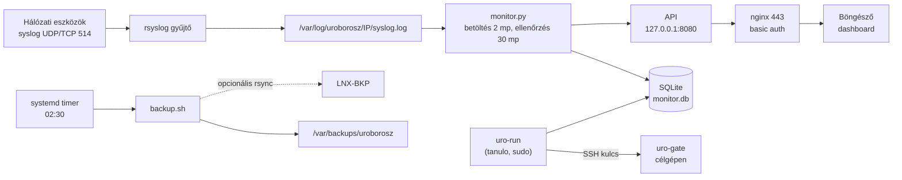

# LNX-OPS szerver - beállítás és elkészítés (labor)

Készítette: Holósi Tamás - Forgács-Balajthy Marcell - Szakmai vizsgaremek - Uroborosz Biztonság Kft.
Dátum: 2026-10-14 - VirtualBox 7.2.16 - Ubuntu 24.04.4 LTS


## 1. Áttekintés

Az LNX-OPS az Uroborosz Biztonság Kft. SOC- és felügyeleti szervere. A hálózati leírás szerint a budapesti központ SERVERS szegmensében van (VLAN 30, 10.1.30.20/24), ez a "Syslog" szerver, amelyre minden hálózati eszköz naplózik.

Amit tud:

- **syslog-gyűjtő** (rsyslog, UDP és TCP 514), hostonként külön naplófájllal;
- **HTTPS-es dashboard** (Python + SQLite): szolgáltatás- és portellenőrzés, élő napló, utolsó mentés ideje;
- **kulcsos SSH-s, jóváhagyott szkriptfuttatás** (`uro-run`), auditnaplóval és célgép-oldali kapuval;
- **napi mentés** helyi másolattal, opcionális rsync-kel az LNX-BKP-re;
- **Uroborosz arculat**: monokróm MOTD, prompt és állapotoldal.

Nem része: a Packet Tracer és a VirtualBox összekötése (nem szükséges), a névfeloldás (a WIN-DC1 elkészültéig vár), a Windows-célgépek ügynöke.

## 2. Architektúra



Jelmagyarázat: folytonos nyíl = adatáramlás, szaggatott nyíl = még nincs bekapcsolva.

## 3. Alapok: VM, hálózat, rendszer

| Beállítás | Érték |
| --- | --- |
| Virtuális gép | LNX-OPS, VirtualBox 7.2.16, Windows 10 host |
| Operációs rendszer | Ubuntu 24.04.4 LTS, kernel 6.8.0-138-generic |
| Erőforrás | 2 vCPU, 4 GB RAM, 24 GB lemez |
| Hálózati adapter | 1 db, NAT Network `Budapest` (10.1.30.0/24, gateway 10.1.30.1, DHCP nélkül) |
| IP-cím | 10.1.30.20/24, statikus |
| DNS | 10.1.30.10 (WIN-DC1), tartalék 8.8.8.8, keresési tartomány `uroborosz.local` |
| Gépnév | `lnx-ops.uroborosz.local` (`/etc/hosts` bejegyzéssel) |
| Idő | Europe/Budapest, chrony szinkronizál |
| Billentyűkiosztás | magyar |
| Guest Additions | 7.2.16, a host saját ISO-járól |
| Csomagok | openssh-server, nginx, rsyslog, python3-venv, python3-pip, sqlite3, ufw, chrony, openssl, rsync; a Guest Additions fordításához build-essential, dkms, linux-headers |

Netplan (`/etc/netplan/01-uroborosz.yaml`, jogosultság 600; az eredeti `50-cloud-init.yaml` a `/root`-ba került mentésként):

```yaml
network:
  version: 2
  ethernets:
    enp0s3:
      dhcp4: false
      addresses: [10.1.30.20/24]
      routes:
        - to: default
          via: 10.1.30.1
      nameservers:
        search: [uroborosz.local]
        addresses: [10.1.30.10, 8.8.8.8]
```

A `Budapest` NAT hálózaton nincs DHCP, ezért kell a statikus cím. A WIN-DC1 jelenleg nem fut, a DNS ilyenkor a 8.8.8.8-ra esik vissza.

## 4. Az építés lépései

A szervert a VirtualBox MCP-n keresztül állítottuk be: az első lépések a VM konzoljára gépeltek (`vm_type`), a Guest Additions telepítése után már a `guest_exec` futtatta a parancsokat.

1. **Konzol-hozzáférés.** A VM be volt lépve `tanulo` felhasználóval a tty1-en. A vendég billentyűkiosztása magyar, ezért a gépelés `hu` kiosztással megy.
2. **Hálózat.** A `Budapest` NAT hálózaton nem volt DHCP, ezért statikus címet kapott (3. fejezet). Ellenőrzés: ping 8.8.8.8 és `archive.ubuntu.com`.
3. **Guest Additions.** A VM-ben a 6.0.0-s verzió volt, ez a host 7.2.16-os verziójával nem működött együtt (`guest_exec` nem indult). A host `VBoxGuestAdditions.iso` fájlját az IDE DVD-meghajtóba csatoltuk, telepítettük a build-essential, dkms és linux-headers csomagokat, majd lefuttattuk a `VBoxLinuxAdditions.run`-t. Utána az ISO kivétele (`eject`).
4. **Alaprendszer.** Gépnév `lnx-ops`, `/etc/hosts` bejegyzés, időzóna, csomagok telepítése.
5. **SSH.** Keményítés és banner (4.1).
6. **rsyslog-gyűjtő, tűzfal, nginx** (5. fejezet).
7. **Monitor és dashboard** (6. fejezet).
8. **SSH-s szkriptfuttatás** (7. fejezet).
9. **Mentés** (8. fejezet).
10. **Arculat** (9. fejezet).
11. **Végpontok közötti teszt** (11. fejezet).

### 4.1 SSH

Fájl: `/etc/ssh/sshd_config.d/10-uroborosz.conf`

```
PermitRootLogin no
MaxAuthTries 4
LoginGraceTime 30
X11Forwarding no
ClientAliveInterval 300
ClientAliveCountMax 2
Banner /etc/issue.net
AllowUsers tanulo
```

A banner (`/etc/issue.net` és `/etc/issue`) megegyezik a hálózati eszközökön használttal: `Uroborosz Biztonsag Kft. - csak jogosult hasznalat`. A szkriptfuttatáshoz telepített ügynök egy második fájlt ad hozzá (`20-uroexec.conf`: `AllowUsers uroexec`).

## 5. Szolgáltatások

### 5.1 rsyslog-gyűjtő

Fájl: `/etc/rsyslog.d/10-uroborosz-collector.conf`

- UDP és TCP 514 bemenet, külön `ruleset`-tel, így a távoli naplók nem keverednek a helyiekkel.
- Hostonként külön fájl: `/var/log/uroborosz/<küldő IP>/syslog.log` (könyvtár 755, fájl 640, tulajdonos `syslog:adm`).
- A naplósor formátuma a `UroLine` sablon szerint: `időbélyeg küldő-IP súlyosság tag üzenet`. A súlyosság azért kell, mert a dashboard ebből készít INFO/WARNING/ERROR szintet.
- Forgatás: `/etc/logrotate.d/uroborosz`, naponta, 14 példány, tömörítve.

Súlyosság-leképezés a dashboardon:

| rsyslog szint | Dashboard |
| --- | --- |
| emerg, alert, crit, err | ERROR |
| warning | WARNING |
| notice, info, debug | INFO |

### 5.2 Tűzfal (ufw)

Alapértelmezés: bejövő tiltva, kimenő engedve. A szabályok a hálózati leírás MGMT-ACL-jéhez igazodnak.

| Port | Honnan | Mire |
| --- | --- | --- |
| 22/tcp | 10.1.40.0/24, 10.1.254.0/29, 172.16.0.0/16, 10.1.30.0/24 | SSH (MGMT hálózatok és a szerver-szegmens) |
| 80/tcp, 443/tcp | 10.0.0.0/8, 172.16.0.0/16 | dashboard (80 csak átirányít) |
| 514/udp, 514/tcp | 10.0.0.0/8, 172.16.0.0/16 | syslog |

### 5.3 nginx

Fájl: `/etc/nginx/sites-available/uroborosz` (a `default` oldal törölve).

- 80-as port: 301 átirányítás HTTPS-re.
- 443-as port: TLS 1.2 és 1.3, önaláírt tanúsítvány (`/etc/ssl/certs/uroborosz.crt`, kulcs `/etc/ssl/private/uroborosz.key`, 825 nap, SAN: `lnx-ops.uroborosz.local`, `lnx-ops`, `10.1.30.20`).
- Belépés: basic auth (`/etc/nginx/uroborosz.htpasswd`, `tanulo` felhasználó), kivéve a `/health` végpontot (`ok`).
- `/api/` a `127.0.0.1:8080` címre proxyzik; a statikus oldal a `/var/www/uroborosz/index.html`.
- Fejlécek: `X-Content-Type-Options`, `X-Frame-Options: DENY`, `Referrer-Policy: no-referrer`, szigorú `Content-Security-Policy` (csak saját API-hívás), `server_tokens off`.

## 6. Monitor és dashboard

A program `/opt/uroborosz/app/monitor.py`, csak a Python szabványos könyvtárát használja. A `uroborosz-monitor` systemd szolgáltatás futtatja `uromon` rendszerfelhasználóval (az `adm` csoport tagja, hogy olvassa a naplókat).

Szolgáltatás-keményítés: `ProtectSystem=strict`, `ReadWritePaths=/opt/uroborosz/data`, `ProtectHome=true`, `PrivateTmp=true`, `Restart=on-failure`. Az API csak a loopbackre kötődik.

### 6.1 Feladatai

| Szál | Ütem | Feladat |
| --- | --- | --- |
| Betöltő | 2 mp | az új naplósorok beolvasása a hostonkénti fájlokból (fájl-azonosító és pozíció alapján, a forgatást kezeli) az `events` táblába |
| Ellenőrző | 30 mp | a `targets.json` szerinti ellenőrzések futtatása, állapot (`state`) és állapotváltás-előzmény (`checks`) vezetése |
| Takarító | 1 óra | régi sorok törlése (legfeljebb 200 000 esemény, 5000 ellenőrzés, 2000 művelet marad) |

Állapotváltáskor (UP ↔ DOWN) a monitor saját eseményt ír a naplóba (`lnx-ops` host, INFO vagy ERROR szint).

### 6.2 Ellenőrzések (`/opt/uroborosz/data/targets.json`)

| Típus | Mit csinál |
| --- | --- |
| `systemd` | `systemctl is-active <egység>` |
| `tcp` | TCP-kapcsolat nyitása `host:port` címre, 2 mp időtúllépéssel |
| `icmp` | egy `ping`, 2 mp várakozással |

Bekapcsolt ellenőrzések: 6 szolgáltatás (`ssh`, `rsyslog`, `nginx`, `chrony`, `ufw`, `uroborosz-monitor`) és 3 port (`10.1.30.20:22`, `:443`, `:514`).

Előkészítve, de kikapcsolva (`"enabled": false`), amíg a VM-ek üresek: `WIN-DC1 dns` (10.1.30.10:53), `LNX-WEB https` (10.1.100.10:443), `LNX-BKP ssh` (10.2.30.10:22). Új cél felvétele: a `targets.json` bővítése, újraindítás nem kell.

### 6.3 API (csak olvasás, `127.0.0.1:8080`, nginx-en át `/api/...`)

| Végpont | Tartalom |
| --- | --- |
| `/api/summary` | 24 órás eseményszámok szint szerint, ellenőrzések UP/DOWN száma, naplózó hosztok száma, mentés állapota |
| `/api/checks` | ellenőrzések aktuális állapota |
| `/api/events?limit=&sev=&host=` | legutóbbi események (legfeljebb 500), szűrhető szintre és hostra |
| `/api/actions` | utolsó 20 távoli művelet |
| `/api/scripts` | jóváhagyott szkriptek listája |

### 6.4 Felület

Cím: `https://10.1.30.20/`. Az oldal 5 másodpercenként frissül, és ezeket mutatja: összesítő sáv (ellenőrzések, 24 órás ERROR/WARNING/INFO, naplózó hosztok, utolsó mentés), szolgáltatások és eszközök táblázata, élő napló szűrővel (szint és host), távoli műveletek és a jóváhagyott szkriptek listája.

A naplóüzenetek mindig csak szövegként jelennek meg (`textContent`), így a hálózatról érkező tartalom nem tud kódot futtatni az oldalon.

## 7. Szkriptfuttatás SSH-n

A cél: a felügyeleti szerverről csak előre jóváhagyott szkriptek futhassanak a gépeken, kulcsos SSH-val, naplózva.

### 7.1 Vezérlő oldal (LNX-OPS)

- Parancs: `uro-run <cél> <szkript>`, vagy `uro-run --list`. A `/usr/local/bin/uro-run` egy `sudo -u uromon` burkoló, a `tanulo` felhasználó csak ezt az egy programot futtathatja `uromon`-ként (`/etc/sudoers.d/uroborosz`).
- SSH-kulcs: `/opt/uroborosz/.ssh/uro_ed25519` (ed25519, `uromon` tulajdonában, 600). Az első kapcsolatnál az ujjlenyomatot a `known_hosts` rögzíti (`accept-new`).
- Célok: `/opt/uroborosz/data/hosts.json` (jelenleg `lnx-ops-self`, ez az LNX-OPS saját magára, tesztelésre).
- Jóváhagyott szkriptek: `/opt/uroborosz/data/scripts.json`: `uptime`, `disk`, `mem`, `failed-units`.
- Audit: minden futás (az elutasítottak is) bekerül az `actions` táblába (ki, cél, szkript, kilépési kód, kimenet) és a syslogba (`uro-run` tag).

| Kilépési kód | Jelentés |
| --- | --- |
| 0 | sikeres futás |
| 64 | hibás használat |
| 65 | ismeretlen cél |
| 66 | nem jóváhagyott szkript |
| 124 | időtúllépés (30 mp) |

### 7.2 Célgép oldal (ügynök)

A telepítő: `/opt/uroborosz/agent/install-agent.sh '<publikus kulcs>'` (root-ként futtatandó). Ezt hozza létre:

- `uroexec` felhasználó, zárolt jelszóval, csak kulcsos belépéssel;
- az `authorized_keys` bejegyzése `restrict,command="/usr/local/sbin/uro-gate"` kényszerítéssel, vagyis a kulccsal semmi más nem futtatható, nincs pty és nincs továbbítás;
- `/usr/local/sbin/uro-gate`: a kapu, amely a kapott azonosítót (csak kisbetű, szám és kötőjel) a `/etc/uroborosz/agent-scripts.d/` mappa végrehajtható fájljaival veti össze, és csak azt futtatja; minden futás a syslogba kerül (`uro-gate` tag);
- a négy kiinduló szkript (`uptime`, `disk`, `mem`, `failed-units`).

Így két helyen is van védelem: a vezérlő csak a listán szereplő szkriptet kéri, a célgép pedig a saját listáján kívül semmit nem futtat. Új célgépre ugyanez a telepítő kerül, a Windows-gépekhez külön megoldás kell.

## 8. Mentés

Szkript: `/opt/uroborosz/bin/backup.sh` (root, 755). Időzítő: `uroborosz-backup.timer`, naponta 02:30 (`Persistent=true`, legfeljebb 5 perc véletlen késleltetés).

Egy futás három állományt készít a `/var/backups/uroborosz` mappába (750, root):

| Fájl | Tartalom |
| --- | --- |
| `monitor-<idő>.db` | az SQLite adatbázis konzisztens mentése (`.backup`) |
| `config-<idő>.tgz` | rsyslog, nginx, sshd, netplan, ufw szabályok, `/etc/uroborosz`, a monitor adatfájljai (`*.json`), `app`, `bin`, `agent`, a weboldal |
| `logs-<idő>.tgz` | a `/var/log/uroborosz` naplók |

A 14 napnál régebbi állományok törlődnek. Az SSH privát kulcsok és a jelszófájl nem kerülnek bele.

**Távoli másolat az LNX-BKP-re:** a `/etc/uroborosz/backup.env.example` alapján kell egy `backup.env`, benne `BKP_TARGET=felhasznalo@10.2.30.10:/srv/backup/lnx-ops/` (és opcionálisan `BKP_KEY`). Amíg ez nincs kitöltve, csak helyi mentés készül. Ehhez az LNX-BKP-n létre kell hozni a fogadó felhasználót és a kulcsot.

Az eredményt a `/opt/uroborosz/data/backup-status.json` tárolja, a dashboard ebből mutatja az utolsó mentés idejét és állapotát (OK vagy ERROR).

## 9. Arculat

Az Uroborosz dizájn rendszer szerint: monokróm, extra színek nélkül, a státusz mindig szóval jelölve (INFO fehér, WARNING szürkés, ERROR fekete kerettel).

- **MOTD:** `/etc/update-motd.d/00-uroborosz` (hoszt, IP, szerep, uptime, terhelés, jogi figyelmeztetés); az alapértelmezett Ubuntu MOTD-elemek le vannak tiltva, a `motd-news` időzítő is.
- **Prompt:** monokróm `PS1`, kikapcsolt `ls`/`grep` színek (`~/.bashrc` és `/etc/skel/.bashrc`).
- **Oldal:** sötét háttér, `JetBrains Mono` és `Space Grotesk` betűkészlet, a betűk nincsenek beágyazva, rendszerbetű a tartalék.
- A szövegek ékezet nélküliek a parancssori kimeneteken és a bannerben (a hálózati eszközök bannerével egyezően).

## 10. Hozzáférések (labor)

| Mire | Felhasználó | Jelszó / módszer |
| --- | --- | --- |
| SSH és konzol (sudo joggal) | `tanulo` | `Umszki123` |
| Dashboard (nginx basic auth) | `tanulo` | `Umszki123` |
| Monitor szolgáltatás | `uromon` | nincs belépés (rendszerfelhasználó, `nologin`) |
| Távoli szkriptfuttatás (célgép) | `uroexec` | zárolt jelszó, csak az `uro_ed25519` kulcs, kényszerített paranccsal |

A `tanulo` jelszava eldobható labor-jelszó. Éles környezetben cserélendő, a dashboard belépése külön fiókot kapjon.

## 11. Tesztek

| Teszt | Eredmény |
| --- | --- |
| Hálózat: ping 8.8.8.8 és `archive.ubuntu.com` a statikus cím után | sikeres |
| Szolgáltatások (`ssh`, `rsyslog`, `nginx`, `chrony`, `ufw`, `uroborosz-monitor`) | mind aktív és engedélyezett |
| Nyitott portok | 22, 80, 443, 514 (TCP), 514 (UDP) |
| Syslog UDP és TCP 127.0.0.1-ről, err/warning/info szinttel | mindhárom bekerült az adatbázisba, helyes szinttel |
| Az üzenetben lévő `<script>` tag | szövegként jelent meg, nem futott |
| nginx belépés (`/`, `/api/summary`) | auth nélkül 401, azzal 200 |
| `/health` | auth nélkül is 200 |
| HTTP → HTTPS | 301 átirányítás |
| Állapotváltás: a `chrony` leállítása | 22 mp alatt DOWN, ERROR esemény; indítás után 23 mp alatt UP, INFO esemény |
| `uro-run lnx-ops-self uptime / disk / failed-units` | sikeres (0) |
| `uro-run lnx-ops-self rm` | elutasítva (66) |
| `uro-run nincs-ilyen uptime` | elutasítva (65) |
| Kapu megkerülése: `cat /etc/shadow`, `uptime; id`, üres parancs az `uroexec` kulccsal | mindhárom elutasítva (`uro-gate: ervenytelen azonosito`, 2) |
| Mentés kézi indítása | OK, három állomány készült, a státusz megjelent az API-ban |
| Időzítő | következő futás: másnap 02:30 |

A tesztek után a teszt-események, az ellenőrzési előzmények és az auditsorok törölve lettek, a dashboard tiszta lappal indul. A felület megjelenését böngészőben nem néztük meg: a host gépről nem érhető el a 10.1.30.20.

## 12. Üzemeltetés

### 12.1 Fontos fájlok

| Fájl / mappa | Mire |
| --- | --- |
| `/etc/netplan/01-uroborosz.yaml` | hálózat |
| `/etc/ssh/sshd_config.d/10-uroborosz.conf`, `20-uroexec.conf` | SSH |
| `/etc/rsyslog.d/10-uroborosz-collector.conf` | syslog-gyűjtő |
| `/var/log/uroborosz/<IP>/syslog.log` | távoli naplók |
| `/etc/nginx/sites-available/uroborosz`, `/etc/nginx/uroborosz.htpasswd` | webszerver, belépés |
| `/var/www/uroborosz/index.html` | dashboard oldal |
| `/opt/uroborosz/app/monitor.py` | monitor |
| `/opt/uroborosz/data/` | `monitor.db`, `targets.json`, `hosts.json`, `scripts.json`, `backup-status.json`, `known_hosts` |
| `/opt/uroborosz/bin/` | `uro-run.py`, `backup.sh` |
| `/opt/uroborosz/agent/` | ügynök (kapu, szkriptek, telepítő) |
| `/etc/uroborosz/` | `backup.env.example`, célgépen az `agent-scripts.d/` |
| `/var/backups/uroborosz/` | helyi mentések |

### 12.2 Gyakori parancsok

```
systemctl status uroborosz-monitor          # monitor állapota
journalctl -u uroborosz-monitor -n 50       # monitor naplója
systemctl list-timers uroborosz-backup.timer
sudo systemctl start uroborosz-backup.service   # mentés azonnal
uro-run --list                              # célok és jóváhagyott szkriptek
uro-run lnx-ops-self uptime                 # szkript futtatása
sudo ufw status                             # tűzfalszabályok
sudo nginx -t && sudo systemctl reload nginx
```

### 12.3 Új szkript jóváhagyása

1. Szkript a célgépen: `/etc/uroborosz/agent-scripts.d/<azonosító>` (végrehajtható, azonosító csak kisbetű, szám, kötőjel).
2. Felvétel a vezérlőn: `/opt/uroborosz/data/scripts.json`.
3. Ellenőrzés: `uro-run <cél> <azonosító>`.

### 12.4 Új célgép felvétele

1. Az ügynök telepítése a célgépen: `install-agent.sh` a `/opt/uroborosz/.ssh/uro_ed25519.pub` tartalmával.
2. Bejegyzés a `hosts.json`-ba (`ip`, `user: uroexec`, `port`).
3. Opcionálisan ellenőrzés a `targets.json`-ba, és a naplózás a 10.1.30.20-ra.

## 13. Megoldott problémák az építés közben

| Probléma | Ok | Megoldás |
| --- | --- | --- |
| A `guest_exec` nem indult | a vendég Guest Additions 6.0.0, a host 7.2.16 | a host saját ISO-járól újratelepítve |
| A begépelt szöveg elcsúszott (`yz-/;=` helyett `zyü-éő`) | a vendég billentyűkiosztása magyar | a gépelés `hu` kiosztással |
| Nincs hálózat | a `Budapest` NAT hálózaton nincs DHCP | statikus cím netplannel |
| Az nginx nem indult (`unknown directive "http2"`) | az Ubuntu 24.04 nginx 1.24-es verziója a `http2 on;` direktívát nem ismeri | `listen 443 ssl http2 default_server;` |
| Az ISO kiadása sikertelen (`VERR_PDM_MEDIA_LOCKED`) | a vendég lezárta a meghajtót | `eject /dev/sr0` a vendégben, utána a kivétel |
| A tesztszkript félbeszakadt a `uro-run` hívásnál | az `ssh` elfogyasztotta a hívó szkript stdin-jét | a `uro-run` `ssh -n` kapcsolóval hívja, `LogLevel=ERROR` mellett |
| `motd-news.service` hibásként látszott | a MOTD cseréje után nem fut | az időzítő kikapcsolva, a hiba törölve |


- **Névfeloldás:** a `lnx-ops.uroborosz.local` rekord felvétele a WIN-DC1 DNS-ében, ha a gép elkészült.
